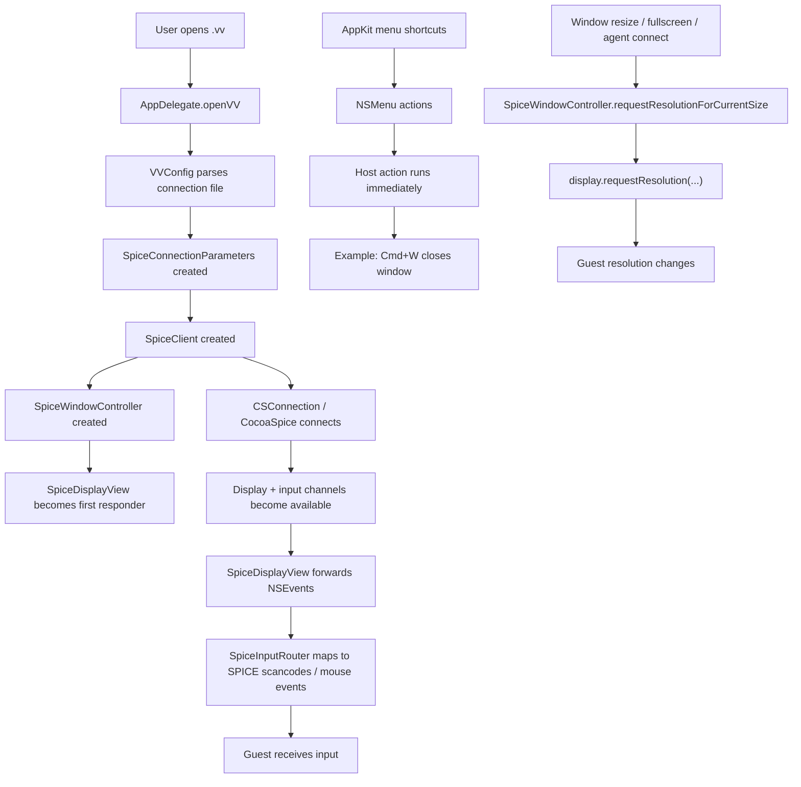

# SpiceMac Working Spec

This document captures the current project structure, the initial product gaps,
the expected behavior relative to virt-viewer / remote-viewer, and a practical
implementation plan.

## Goal

Make SpiceMac behave more like virt-viewer for focused guest interaction:

- When the guest display has keyboard focus, normal shortcuts such as `Cmd+W`
  should go to the guest instead of closing the host window.
- Client-side escape hatches should remain available, but only as explicit
  client hotkeys/actions.
- Dynamic guest resize should be user-controllable, with an option to disable it.
- one time some keys when pressed, multiple/several keys get typed in the guest vm. probably
  the issue is in the wait time on the vm side?

## Initial Requirements

## Implementation Status

- Implemented: guest-focused keyboard handling now removes ordinary host menu
  accelerators such as `Cmd+W`, `Cmd+C`, `Cmd+V`, and `Cmd+O`, so those
  combinations can reach the VM while the display has focus.
- Implemented: `SpiceDisplayView` now handles focused key-equivalent events and
  forwards ordinary command/control/option shortcuts to the guest.
- Implemented: explicit client escape hatches remain local for toggle fullscreen,
  release cursor, quit, and hide.
- Implemented: a persisted `Resize Guest to Window` menu preference controls
  dynamic guest-resolution requests.
- Implemented: macOS auto-repeat keydown events are no longer forwarded to the
  guest, so the guest OS owns repeat behavior from one physical key press.
- Verified: `make doctor`, `make build`, and `make test` pass locally.

### R1. Guest-first keyboard handling in fullscreen

Desired behavior:

- In fullscreen, while the guest display is focused, ordinary key combinations
  should be delivered to the VM.
- Host accelerators such as `Cmd+W` should not close the SpiceMac window when
  the intent is guest input.
- This should feel like VNC / virt-viewer: the guest owns the keyboard while the
  display widget is focused.

Client-only exceptions:

- Explicit client hotkeys such as release cursor and toggle fullscreen may stay
  local.
- Those hotkeys should be deliberate and configurable, not accidental side
  effects of standard macOS menu shortcuts.

### R2. Option to disable auto resizing

Desired behavior:

- Add a preference to disable automatic guest resolution changes.
- When disabled, resizing the host window or entering/exiting fullscreen should
  only change local scaling, not request a new guest resolution.
- When enabled, keep the current dynamic-resolution behavior.

### R3. Use virt-viewer as the functional reference

Use virt-viewer / remote-viewer behavior as the reference point for:

- keyboard focus and hotkey semantics
- fullscreen behavior
- connection-file hotkeys
- dynamic resize expectations

## Upstream Reference Model

Reference target:

- `virt-viewer` / `remote-viewer`
- User-facing behavior reference: `remote-viewer(1)`

Key upstream behavior to mirror:

- Guest widget focus means normal shortcuts go to the guest.
- Client hotkeys are separate from normal guest key delivery.
- Fullscreen can trigger guest monitor reconfiguration when supported.
- Connection files can describe `toggle-fullscreen` and `release-cursor`
  hotkeys.

## Current SpiceMac Structure

### High-level modules

- `Sources/SpiceMac`
  - AppKit app shell, menu, window lifecycle, `.vv` opening, preferences
- `Packages/SpiceController`
  - SPICE connection lifecycle, input routing, pasteboard bridge
- `Packages/VVConfig`
  - `.vv` parser and connection-parameter derivation
- `Packages/SpiceInputMap`
  - macOS virtual key -> SPICE scancode map
- `ThirdParty/CocoaSpice`
  - Objective-C SPICE bridge / renderer / USB / display / clipboard handling
- `Frameworks/`
  - Native dependency sysroot staged at build time

### Key files for the current problems

- `Sources/SpiceMac/MainMenu.swift`
  - Defines menu-level host key equivalents such as `Cmd+W`
- `Sources/SpiceMac/SpiceWindowController.swift`
  - Triggers guest resolution requests on connect, resize, and fullscreen
- `Sources/SpiceMac/Preferences.swift`
  - Current user preferences
- `Sources/SpiceMac/SpiceDisplayView.swift`
  - First-responder display view that receives keyboard and mouse events
- `Packages/SpiceController/Sources/SpiceController/SpiceInputRouter.swift`
  - Converts AppKit events into guest key/mouse input

## Current Flow

## Current Gap Analysis

### Gap 1. Host menu accelerators win over guest input

Current behavior:

- `MainMenu.swift` binds `Cmd+W` directly to `NSWindow.performClose(_:)`.
- `SpiceDisplayView` does receive `keyDown`, `keyUp`, and `flagsChanged`, but
  menu accelerators are resolved before that path can fully own the shortcut.

Impact:

- In fullscreen, `Cmd+W` closes the SpiceMac window instead of reaching the VM.
- This breaks the expected remote-console model.

Likely fix direction:

- Remove or gate host menu key equivalents while the display has guest focus.
- Introduce explicit client hotkey handling in the focused display/input path.
- Keep client actions such as release cursor and toggle fullscreen, but move them
  out of generic host menu shortcuts.

### Gap 2. Dynamic resize is always on

Current behavior:

- On agent connect, SpiceMac requests a resolution for the current window size.
- It also requests resolution on:
  - end of live resize
  - enter fullscreen
  - exit fullscreen

Impact:

- Users cannot keep a fixed guest resolution while resizing the host window or
  changing fullscreen state.

Likely fix direction:

- Add a persisted preference, for example `autoResizeGuestDisplay`.
- Gate all `requestResolutionForCurrentSize()` call sites on that preference.
- Keep local aspect-fit scaling independent from guest resize.

## SpiceMac vs virt-viewer

### Similarities

- Both consume virt-viewer style `.vv` files.
- Both support SPICE fullscreen startup.
- Both support explicit connection-file hotkeys such as fullscreen and release
  cursor.
- Both support dynamic guest resize when the guest agent and backend support it.

### Differences today

- SpiceMac currently exposes normal macOS menu shortcuts even while the guest
  display is focused.
- SpiceMac does not yet model client hotkeys as a separate, explicit layer.
- SpiceMac currently lacks a user-facing toggle for automatic guest resizing.
- virt-viewer is the mature upstream reference; SpiceMac is a narrower native
  macOS client built around CocoaSpice.

### Design target

- Adopt virt-viewer semantics:
  - guest focus -> keys go to guest
  - explicit client hotkeys -> stay local
  - auto resize -> user-controllable

## Proposed TODO

### Phase 1. Keyboard / hotkey model

- Done: audit all menu items with key equivalents.
- Done: remove host key equivalents that should not preempt guest input.
- Done: add a focused key-equivalent path in `SpiceDisplayView`.
- Done: reserve explicit client actions:
  - release cursor
  - toggle fullscreen
  - quit/hide app
- Done: make guest-focus behavior the default in fullscreen and normal
  connected mode as well.

### Phase 2. Auto-resize preference

- Done: add a new preference in `Preferences.swift`.
- Done: add `Resize Guest to Window` under the Connection menu.
- Done: gate these sites on the new preference:
  - agent-connected callback
  - `windowDidEndLiveResize`
  - `windowDidEnterFullScreen`
  - `windowDidExitFullScreen`

### Phase 3. Config / compatibility cleanup

- Decide whether to honor `.vv` hotkey hints more directly.
- Optionally align naming with virt-viewer terminology.
- Add lightweight tests for the new preference logic and input-routing rules
  where feasible.

## Difficulty Estimate

### 1. Guest-first keyboard handling

Difficulty: Medium

Why:

- The input-routing code already exists and is reasonably isolated.
- The tricky part is AppKit shortcut precedence and preserving a clean path for
  explicit client hotkeys without breaking normal macOS menu behavior elsewhere.
- This needs careful manual testing in windowed mode, fullscreen, and focus-loss
  transitions.

Expected effort:

- Roughly 1 to 2 focused implementation sessions.

### 2. Disable auto resizing

Difficulty: Low

Why:

- The resize requests already funnel through one controller.
- This is mostly a preference, menu item, and a few guard conditions.

Expected effort:

- Roughly a half session to one session.

### 3. Matching virt-viewer semantics more broadly

Difficulty: Medium

Why:

- The main work is not the resize toggle itself; it is agreeing on exactly which
  key combinations remain local and which must always go to the guest.
- Once that policy is settled, the implementation is straightforward.

## Recommended Implementation Order

1. Add the auto-resize preference first.
2. Rework host vs guest shortcut ownership.
3. Add explicit client hotkeys and polish semantics to match virt-viewer.

## Open Questions

- Should guest-first keyboard handling apply only in fullscreen, or any time the
  remote display has focus?
- Which client hotkeys should be reserved by default?
- Should `Cmd+Q` remain host-local always, or also become guest-first while
  focused?
- Do we want a visible menu toggle for keyboard grab / release, or only a hotkey?
